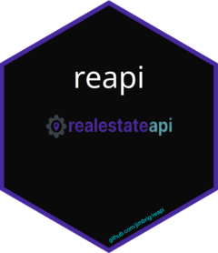

# reapi <a href="http://docs.jimbrig.com/reapi/"></a>

<!-- badges: start -->
[](https://cran.r-project.org/)
[]()

[](https://api.realestateapi.com/reference)
[](https://api.realestateapi.com/swagger.json)
[](https://staging.realestateapi.com/swagger.json)

[](https://github.com/jimbrig/reapi/actions/workflows/changelog.yml)
[](https://github.com/jimbrig/reapi/actions/workflows/pkgdown.yml)
[](https://github.com/jimbrig/reapi/actions/workflows/check.yml)
<!-- badges: end -->

***

> [!NOTE]
> **[Real Estate API](https://realestateapi.com) Integration Client for R**

<p align="center"></p>

***

## Overview

`reapi` is a production-grade, robust R package that provides a comprehensive API client library to interface and integrate
with [Real Estate API](https://realestateapi.com). Built on `httr2`, it offers composable request construction & handling,
intelligent caching, and automatic response tidying for seamless integration into real estate analytics workflows.

## Installation

Install from GitHub via:

```R
pak::pak("jimbrig/reapi")
```

## Resources

See [LINKS.md](LINKS.md) for an exhaustive list of Real Estate API related resources and URLs.

## License

See [LICENSE](LICENSE): Copyright 2026 - Jimmy Briggs <jimmy.briggs@jimbrig.com>
